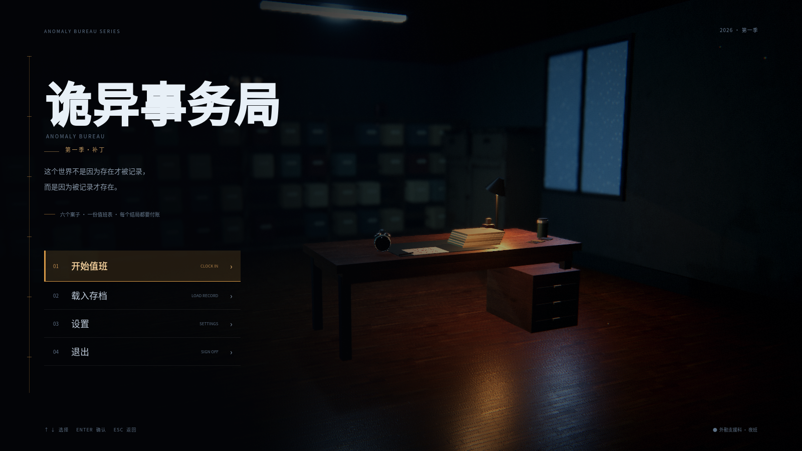
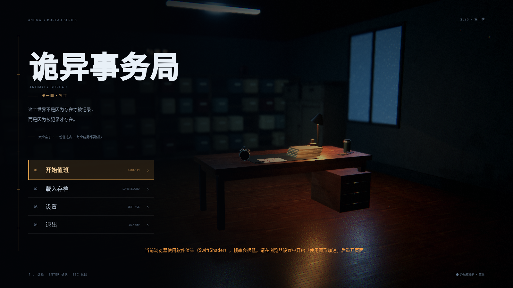

# 先看这个 · 《诡异事务局》第一季「补丁」交接

> 2026-10-19 · 项目交接入口  
> 线上：https://visionary-concha-bf9fea.netlify.app

---

## 1. 现在是什么状态

- 主工程：Godot 4.7.2 3D 可玩原型，`岚桥站0017-Godot/`
- 当前线上：`deploy/` 已部署到 Netlify
- 封面已改为：**《诡异事务局》→ 第一季「补丁」**
- **0017 不再出现在封面/主菜单/入口页/浏览器标签**
- 0017 只保留在 **载入存档 → 案卷目录** 里
- 「最后的地铁」不再当系列标题，只作为第一季里的一个事件

---

## 2. 新工作区怎么建（推荐）

建议新目录不要带全角冒号：

`C:\Users\Sabrina\Documents\ChatGPT\最后的地铁_0017_新工作区`

在本目录执行：

```powershell
powershell -ExecutionPolicy Bypass -File "C:\Users\Sabrina\Documents\ChatGPT\最后的地铁：0017\_handover\scripts\prepare_new_workspace.ps1" -Destination "C:\Users\Sabrina\Documents\ChatGPT\最后的地铁_0017_新工作区"
```

默认复制：

- Godot 源码（不含 `.godot` / `_预览` / `.git`）
- `deploy/`
- 根目录剧本/世界观/序章/录制说明/启动 bat
- `_handover/`
- `.netlify/state.json`

想保留 Git 历史：

```powershell
... -WithGit
```

想保留开发截图：

```powershell
... -WithPreviews
```

想带课程作业：

```powershell
... -WithCourseRepo
```

---

## 3. 如果你只想手动复制

### 必带

```text
岚桥站0017-Godot\project.godot
岚桥站0017-Godot\scenes\
岚桥站0017-Godot\scripts\
岚桥站0017-Godot\shaders\
岚桥站0017-Godot\assets\
岚桥站0017-Godot\export_presets.cfg
岚桥站0017-Godot\README.md
deploy\
剧本_最后的地铁_0017_完整季_v5.md
世界观圣经_诡异事务局.md
0017前_序章场景与流程.md
剧本_0017_当前版_v4.md
Godot录制说明.md
启动岚桥站0017-游戏.bat
.netlify\state.json
_handover\
```

### 不要带（省空间）

```text
岚桥站0017-Godot\.godot\    # 160 MB，自动重建
_tools\                     # 1.05 GB，Blender/ffmpeg
_backup\                    # 225 MB
岚桥站0017-Godot\_预览\     # 213 MB，开发截图
0017-网页版*.zip            # 可重新打包
```

---

## 4. 迁移后第一次验证

```powershell
$G = "C:\Users\Sabrina\AppData\Local\Microsoft\WinGet\Packages\GodotEngine.GodotEngine_Microsoft.Winget.Source_8wekyb3d8bbwe\Godot_v4.7.2-stable_win64_console.exe"
$P = "C:\Users\Sabrina\Documents\ChatGPT\最后的地铁_0017_新工作区\岚桥站0017-Godot"
& $G --headless --path $P --quit-after 90
```

退出码 0 即通过。

然后：

```powershell
powershell -File "C:\Users\Sabrina\Documents\ChatGPT\最后的地铁_0017_新工作区\_handover\scripts\export_web.ps1"
powershell -File "C:\Users\Sabrina\Documents\ChatGPT\最后的地铁_0017_新工作区\_handover\scripts\deploy_netlify.ps1"
```

---

## 5. 三个最重要的坑

1. **重新导出 Web 后，浏览器标题会变回「岚桥站 0017」**  
   用 `export_web.ps1`，它会自动修正；手动导出要自己加 `<script>`。

2. **Netlify 部署必须加 `--no-build`**  
   否则可能报 `Failed retrieving extensions ... fetch failed`。

3. **当前 Godot 仓库有未提交改动**  
   `menu.gd`、`game.gd`、`hotbar.gd`、`station.gd`、`ui_flow.gd` 和 `assets/ui/` 等还没提交。  
   不要只 clone `.git`；请复制整个源码目录，或应用 `_handover/patches/`。

---

## 6. 详细文档

- 完整交接说明：`_handover/交接说明_最后的地铁_0017_20261019.md`
- 产物清单 + SHA256：`_handover/产物清单_20261019.md`
- 开发日志：`岚桥站0017-Godot/README.md`
- 剧本：`剧本_最后的地铁_0017_完整季_v5.md`
- 世界观：`世界观圣经_诡异事务局.md`

---

## 7. 当前封面截图




